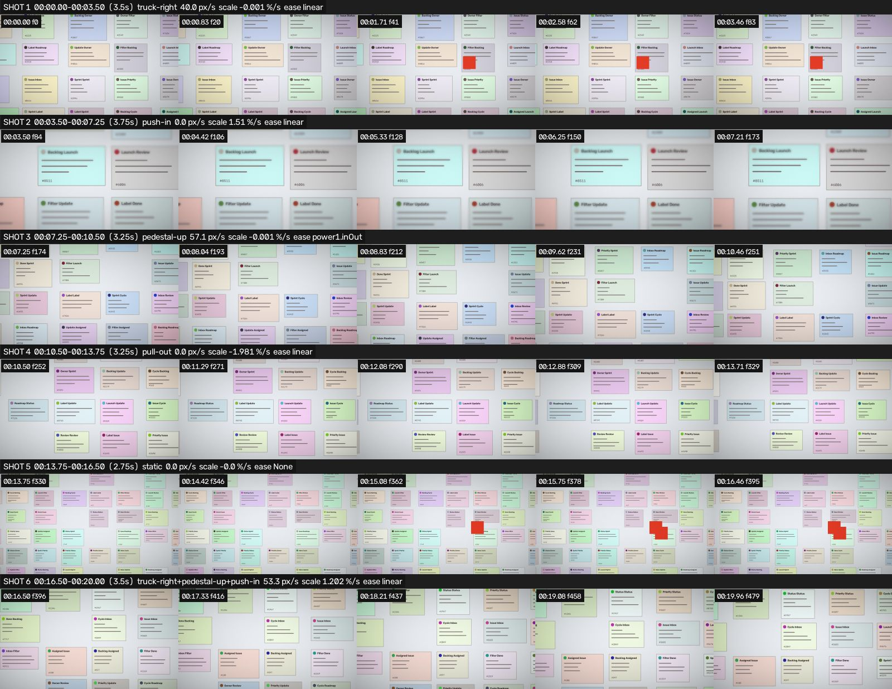
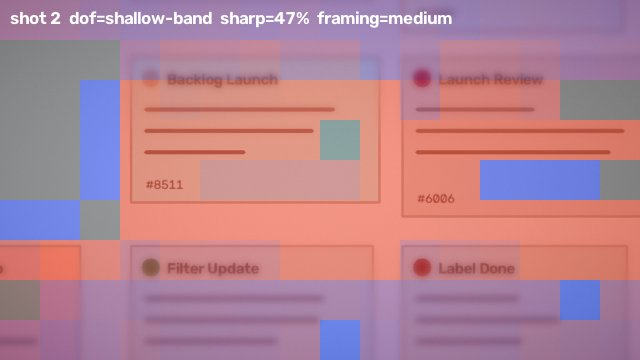

# Synthetic ground-truth reel

A 20 s, 1280×720, 24 fps "launch video" whose camera, edit and sound are **known exactly**, used to
prove that the numbers video-sharingan reports are right.

`make_synthetic.py` draws a procedural UI canvas (cards, text, rules) and renders every frame with a
sub-pixel-exact affine warp, then encodes it with ffmpeg (H.264 + AAC), so the codec is part of the test.

| shot | frames | camera (ground truth) | extras |
|---|---|---|---|
| 1 | 0–83 | truck right: content −40 px/s, linear | 1 UI state change at 1.25 s |
| 2 | 84–173 | push-in +1.511 %/s from 1.6× zoom, linear | tilt-shift blur band (horizontal) |
| 3 | 174–251 | pedestal up 160 px, `power1.inOut` (eased, so it *does* stop) | |
| 4 | 252–329 | pull-out −1.980 %/s, linear | |
| 5 | 330–395 | static, wide (0.6× zoom) | 2 UI state changes |
| 6 | 396–479 | diagonal (−50, +18) px/s + push-in +1.207 %/s | |

Whole reel: vignette (corners at 70 % at the extreme corner), gaussian grain σ = 2 before encoding.
Audio: a 120 BPM kick + sustained pad (music), plus a 6 ms tick on each UI change (SFX). Cuts at
3.5 / 7.25 / 10.5 / 13.75 / 16.5 s, so 3 of the 5 cuts are on the beat.

```bash
./run.sh            # regenerate, analyze, check  ->  results.md
```

- `ground_truth.json`: what's really in the video
- `analysis.json`, `brief.md`: what video-sharingan measured and wrote
- `results.md`: ground truth vs measured, check by check
- `img/`: shot contact sheet and the shot-2 focus heatmap





The video itself is not committed (it's 30 MB and fully reproducible).
